  

  

 

Final-year <b>Computer Science &amp; Business Systems</b> undergraduate with a <b>Java-first</b> skill set 
and strong fundamentals in <b>OOP, DSA, DBMS and Operating Systems</b>. 
I build full-stack Python and React systems, including an AI-powered equity research platform 
using <b>Generative AI, RAG, LangChain and prompt engineering</b>. 
I've shipped platforms used by <b>800+ real users</b> and presented a <b>peer-reviewed paper at ICONIC 2025</b>.

  

 

<!--
  ZENIQ: when you have the details, send them to Claude and the card above will be
  regenerated with the real description, features and stack.
-->

 

 

 

 

  

  

  

 

  

 

 

Open to Java, full-stack and AI opportunities. Say hello.

  

